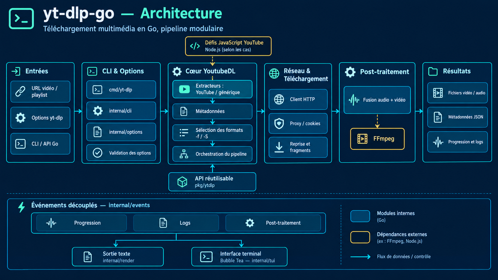
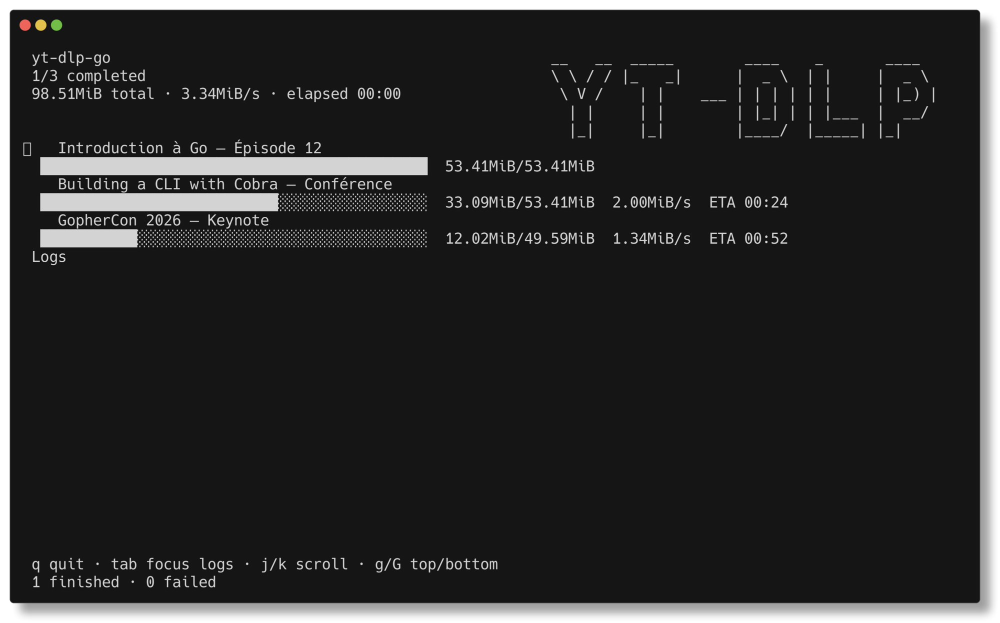

# yt-dlp-go

Portage en Go de [yt-dlp](https://github.com/yt-dlp/yt-dlp) : même interface en
ligne de commande, même logique d'extraction et de sélection de formats, mais
livré sous forme d'un binaire Go unique.

Le projet vise la compatibilité avec les options de yt-dlp et une architecture
en packages claire (`cmd/`, `internal/`, `pkg/`).

[](https://github.com/laurentpoirierfr/yt-dlp-go/releases/latest)
[](https://github.com/laurentpoirierfr/yt-dlp-go/actions/workflows/ci.yml)



## État du projet


| Domaine | État |
| --- | --- |
| Extracteur YouTube (vidéos) | Fonctionnel |
| Extraction générique (og:video, `<video>`/`<source>`, m3u8/mpd) | Fonctionnel |
| Pipeline de sélection de formats (`-f`, `-S`) | Fonctionnel |
| Téléchargement HTTP + fusion ffmpeg | Fonctionnel |
| Métadonnées JSON (`-j`, `-J`) | Fonctionnel |
| Sidecar `.info.json` (`--write-info-json`) | Fonctionnel |
| Vignettes (`--write-thumbnail`, `--write-all-thumbnails`, `--list-thumbnails`) | Fonctionnel |
| Sous-titres (`--write-subs`, `--write-auto-subs`, `--all-subs`, `--sub-langs`, `--sub-format`, `--convert-subs`, `--list-subs`) | Fonctionnel |
| Playlists | Complet (pagination, plages/items, reverse/random, archive) |
| Post-traitements (audio, remux) | Fusion ffmpeg + extraction audio (`-x`) ; `--remux-video` refusé |
| Noms de fichiers (gabarits, `--restrict/windows/trim-filenames`) | Fonctionnel |
| Options non implémentées | Refusées explicitement (plus de no-op silencieux) |
| Interface terminal (IHM Bubble Tea) | Fonctionnelle |

## Prérequis

- Go 1.27+
- `ffmpeg` (fusion vidéo + audio, remux)
- Node.js (uniquement pour résoudre les défis JavaScript de YouTube)

## Installation

### Binaires précompilés

Des binaires pour Linux, macOS et Windows (amd64 et arm64) sont disponibles sur
la [page des releases](https://github.com/laurentpoirierfr/yt-dlp-go/releases/latest).

### Depuis les sources

```console
git clone <ce-depot> yt-dlp-go
cd yt-dlp-go
go build -o yt-dlp-go ./cmd/yt-dlp
```

Ou directement :

```console
go install github.com/laurentpoirierfr/yt-dlp-go/cmd/yt-dlp@latest
```

Exécution depuis les sources (sans compiler de binaire) :

```console
go run . --tui "https://www.youtube.com/watch?v=..."
# équivalent : go run ./cmd/yt-dlp --tui "..."
```

## Utilisation de base

### Extraire une vidéo

```console
yt-dlp-go "https://www.youtube.com/watch?v=dQw4w9WgXcQ"
```

### Lister les formats disponibles

```console
yt-dlp-go -F "https://www.youtube.com/watch?v=dQw4w9WgXcQ"
```

Exemple de sortie :

```
[info] Available formats for dQw4w9WgXcQ:
ID           EXT        RESOLUTION     FPS        VCODEC     ACODEC
139          m4a        audio only     0          none       mp4a.40.5
140          m4a        audio only     0          none       mp4a.40.2
251          weba       audio only     0          none       opus
160          mp4        256x144        25         avc1.4D400C none
137          mp4        1920x1080      25         avc1.640028 none
248          webm       1920x1080      25         vp9        none
313          webm       3840x2160      25         vp9        none
401          mp4        3840x2160      25         av01.0.12M.08 none
```

### Choisir un format

```console
# Une qualité précise
yt-dlp-go -f 137 "URL"

# Meilleure vidéo + meilleur audio, puis fusion
yt-dlp-go -f "bestvideo+bestaudio" "URL"

# Meilleure vidéo avec audio intégré, sinon meilleur couple
yt-dlp-go "URL"

# Audio uniquement
yt-dlp-go -f bestaudio "URL"
yt-dlp-go -f 251 "URL"

# Taille limite : meilleure vidéo <= 720p
yt-dlp-go -f "bestvideo[height<=720]+bestaudio/best[height<=720]" "URL"

# Filtrage par extension / codec
yt-dlp-go -f "bestvideo[ext=mp4]+bestaudio[ext=m4a]" "URL"
```

### Télécharger une playlist

```console
# Toute la playlist (enregistre chaque vidéo, la TUI affiche une barre par vidéo)
yt-dlp-go --tui "https://www.youtube.com/playlist?list=PLzH6n4zXuckpfMu_4Ff8E7Z1behQks5ba"

# Premier tiers de la playlist, qualité limitée, dans un sous-dossier par playlist
yt-dlp-go --playlist-items 1-3 -f "best[height<=720]" \
  -o "%(playlist_title)s/%(playlist_index)s - %(title)s.%(ext)s" "URL"

# Une URL vidéo qui porte aussi une playlist (radio « Mix », etc.)
yt-dlp-go --tui "https://www.youtube.com/watch?v=h87gs1mcxSc&list=RDh87gs1mcxSc&start_radio=1"
```

> Note : l'extraction couvre actuellement la première page de la playlist
> (les premières vidéos). La continuation automatique est en cours de
> développement.
>
> Une URL de type `watch?v=…&list=…` est automatiquement reconnue et ramenée à
> la playlist complète (`https://www.youtube.com/playlist?list=…`). Les radios
> « Mix » (`RD…`), qui n'ont pas de page playlist, sont lues depuis la file de
> la page vidéo.

### Simuler (sans télécharger)

```console
yt-dlp-go -s "URL"              # n'écrit rien sur le disque
yt-dlp-go --get-url "URL"       # affiche l'URL du média sélectionné
yt-dlp-go --get-title "URL"     # affiche le titre
yt-dlp-go --get-id "URL"        # affiche l'identifiant
yt-dlp-go --skip-download "URL" # extrait et affiche, sans télécharger
```

## Interface terminal (IHM)

Lors d'un téléchargement réel dans un terminal interactif, une interface
plein écran (Bubble Tea) est affichée automatiquement. Elle occupe toute la
hauteur du terminal et se compose de :

- **En-tête** : résumé global à gauche (progression des tâches, volume total,
  débit cumulé, temps écoulé) et **logo ASCII `YT-DLP` en haut à droite**.
- **Tâches** : une ligne d'état + une barre de progression par téléchargement,
  avec volume téléchargé/total, débit et ETA.
- **Journal** : logs d'extraction et de post-traitement, défilables, qui
  occupent l'espace restant.
- **Pied de page** : compteurs (terminées / échouées) et rappel des raccourcis.



```console
# Lancée automatiquement sur un terminal interactif
yt-dlp-go "URL"

# Forcer l'interface (même si la détection automatique échoue)
yt-dlp-go --tui "URL"

# Désactiver l'interface : sortie classique, scripts, redirections
yt-dlp-go --no-tui "URL"
```

Règles d'activation :

- activée par défaut pour un vrai téléchargement quand `stdout` est un
  terminal (TTY) ;
- désactivée automatiquement si la sortie est redirigée/pipee (CI, fichiers),
  en mode simulation (`-s`, `-j`, `-J`, `-F`, `--get-*`) ou avec `-q`/`--quiet` ;
- `--tui` force l'affichage, `--no-tui` le désactive.

### Raccourcis clavier

| Touche | Action |
| --- | --- |
| `q`, `esc`, `ctrl+c` | Quitter |
| `tab` | Basculer le focus vers les logs |
| `j` / `k`, `↓` / `↑` | Défiler ligne à ligne |
| `pgup` / `pgdn` | Défiler page à page |
| `g` / `G` | Aller au début / à la fin |

L'interface se ferme automatiquement peu après la fin du dernier
téléchargement, avec un court délai pour lire le résultat.

### Architecture

L'IHM est découplée du cœur : `internal/events` définit le flux d'événements
(progression, post-traitement, logs) et un `Sink`. Le cœur émet via
`YoutubeDL.SetSink`, et l'IHM (`internal/tui`) comme la sortie classique
(`internal/render`) ne sont que deux implémentations de ce `Sink`. Ajouter une
autre sortie (JSON, web) n'affecte donc pas la logique d'extraction ou de
téléchargement.

## Métadonnées

```console
# JSON complet par vidéo
yt-dlp-go -j "URL"

# JSON par URL (playlist entière en un objet)
yt-dlp-go -J "URL"

# Écrire un sidecar <video>.info.json à côté du fichier téléchargé
yt-dlp-go --write-info-json "URL"

# Télécharger la vignette (meilleure) ou toutes les vignettes
yt-dlp-go --write-thumbnail "URL"
yt-dlp-go --write-all-thumbnails "URL"

# Lister les vignettes disponibles sans télécharger
yt-dlp-go --list-thumbnails "URL"

# Forcer un JSON lisible
YTDL_JSON_PRETTY=1 yt-dlp-go -j "URL"
```

`--write-info-json` écrit `<lecteur>.info.json` (le dictionnaire complet de la
vidéo) à côté du fichier médiatique, après un téléchargement réussi.

`--write-thumbnail` écrit la meilleure vignette sous `<lecteur>.<ext>` ;
`--write-all-thumbnails` écrit chaque vignette disponible sous
`<lecteur>.<index>.<ext>` (les vignettes indisponibles sont ignorées avec un
avertissement). `--list-thumbnails` affiche les vignettes disponibles sans rien
télécharger.

`--write-description` n'est pas encore implémenté : il est **refusé
explicitement** (erreur) plutôt qu'ignoré silencieusement.

## Noms et dossiers de sortie

Le gabarit `-o` utilise la syntaxe `%(champ)s` de yt-dlp :

```console
# Titre + id
yt-dlp-go -o "%(title)s [%(id)s].%(ext)s" "URL"

# Classement par chaîne / date
yt-dlp-go -o "%(channel)s/%(upload_date)s - %(title)s.%(ext)s" "URL"

# Uniquement l'id
yt-dlp-go -o "%(id)s.%(ext)s" "URL"

# Dossier de destination
yt-dlp-go -P "/media/videos" "URL"

# Dossier temporaire séparé puis dossier final
yt-dlp-go -P "temp:/tmp" -P "home:/media/videos" "URL"

# Noms de fichiers restreints à l'ASCII
yt-dlp-go --restrict-filenames -o "%(title)s.%(ext)s" "URL"

# Nom basé sur l'id seul
yt-dlp-go --id "URL"
```

Champs disponibles : `title`, `id`, `ext`, `display_id`, `duration`,
`duration_string`, `uploader`, `uploader_id`, `channel`, `channel_id`,
`upload_date`, `release_date`, `extractor`, `extractor_key`, `webpage_url`,
`format_id`, `format`, `resolution`, `width`, `height`, `playlist`,
`playlist_index`, `playlist_id`, `view_count`, `like_count`, `description`.

Le gabarit accepte les spécificateurs de format (`%(playlist_index)02d`), une
valeur par défaut alternative (`%(uploader|inconnu)s`) et le placeholder pour
champ absent (`NA`, configurable). Les caractères interdits par le système de
fichiers sont automatiquement remplacés ; `--restrict-filenames` limite à
`[A-Za-z0-9._-]`, `--windows-filenames` retire les points/espaces finaux et
`--trim-filenames N` limite la longueur.

## Parties et playlists

Le pipeline de traitement des playlists est opérationnel, avec pagination
automatique (les longues playlists sont lues page par page jusqu'à couvrir la
fenêtre demandée) :

```console
# Toute la playlist
yt-dlp-go "https://www.youtube.com/playlist?list=PLAYLIST_ID"

# Uniquement la vidéo, si l'URL référence aussi une playlist
yt-dlp-go --no-playlist "https://www.youtube.com/watch?v=VIDEO_ID&list=PLAYLIST_ID"

# Télécharger la playlist aussi
yt-dlp-go --yes-playlist "URL"

# Plage d'éléments
yt-dlp-go --playlist-start 3 --playlist-end 8 "URL"
yt-dlp-go -I 1:10 "URL"          # éléments 1 à 10
yt-dlp-go -I "1,3,5,-1" "URL"    # sélection explicite (dernier = -1)

# Ordre
yt-dlp-go --playlist-reverse "URL"
yt-dlp-go --playlist-random "URL"

# Arrêter au premier élément déjà téléchargé
yt-dlp-go --download-archive archive.txt --break-on-existing "URL"

# Lister sans télécharger
yt-dlp-go --flat-playlist -J "URL"

# Index et titre de playlist dans le nom de fichier
yt-dlp-go -o "%(playlist)s/%(playlist_index)02d - %(title)s.%(ext)s" "URL"
```

## Sous-titres

Les sous-titres (manuels et automatiques) sont extraits dans les métadonnées
(`-j`/`-J`) et peuvent être écrits sur disque aux formats `json3`, `srv1`,
`srv2`, `srv3`, `ttml` et `vtt`, avec conversion optionnelle vers `srt`/`vtt`.

```console
# Toutes les langues disponibles
yt-dlp-go --all-subs "URL"

# Langues précises (accepter aussi une regex, préfixe "-" pour exclure)
yt-dlp-go --sub-langs "fr,en" --write-subs "URL"

# Sous-titres automatiques
yt-dlp-go --write-auto-subs --sub-langs "en" "URL"

# Formater la préférence et convertir
yt-dlp-go --write-subs --sub-langs "en" --sub-format "vtt/best" --convert-subs srt "URL"

# Lister les langues disponibles sans télécharger
yt-dlp-go --list-subs "URL"
```

Les fichiers sont écrits à côté du média sous la forme `<base>.<lang>.<ext>`
(par exemple `Ma vidéo [id].fr.srt`). `--sub-format` exprime une préférence
séparée par `/` ; les formats non convertibles sont ignorés lors de
`--convert-subs`. `--sub-langs all` (défaut) sélectionne toutes les langues,
`-live_chat` permet d'en exclure.

Inspectez aussi les pistes disponibles via le JSON :

```console
yt-dlp-go -j "URL" | grep -o '"subtitles".*'
```

## Réseau et débogage

```console
# Proxy
yt-dlp-go --proxy "socks5://127.0.0.1:1080" "URL"

# Délai de socket (header/dial/TLS)
yt-dlp-go --socket-timeout 30s "URL"

# User-Agent et en-têtes personnalisés
yt-dlp-go --user-agent "Mozilla/5.0 ..." --add-header "Referer:https://example.com" "URL"

# Certificats non vérifiés (usage ponctuel)
yt-dlp-go --no-check-certificate "URL"

# Limiter le débit (octets/s)
yt-dlp-go --limit-rate 500K "URL"

# Reprises et réessais
yt-dlp-go --continue --retries 10 --fragment-retries 10 "URL"

# Forcer le téléchargement des fichiers existants
yt-dlp-go --force-overwrites "URL"

# Verbeux (debug)
yt-dlp-go -v "URL"

# Silencieux
yt-dlp-go -q "URL"
```

## Post-traitement

La fusion vidéo + audio et l'extraction audio via ffmpeg sont fonctionnelles.
Le remux (`--remux-video`) est encore en cours.

```console
# Conteneur de fusion
yt-dlp-go --merge-output-format mp4 -f "bestvideo+bestaudio" "URL"

# Emplacement de ffmpeg
yt-dlp-go --ffmpeg-location /usr/bin/ffmpeg "URL"

# Audio seul : conversion vers un format donné (le fichier d'origine est
# supprimé après conversion)
yt-dlp-go -x --audio-format mp3 "URL"

# Qualité (0 = meilleur, 9 = pire) ou débit explicite
yt-dlp-go -x --audio-format mp3 --audio-quality 2 "URL"
yt-dlp-go -x --audio-format flac --audio-quality 192K "URL"

# Sans --audio-format, seule la vidéo est retirée (conteneur conservé)
yt-dlp-go -x "URL"

# Conserver le fichier vidéo d'origine (-k/--keep-video)
yt-dlp-go -x --audio-format opus -k "URL"
```

Formats audio supportés : `best`, `aac`, `aiff`, `alac`, `flac`, `m4a`, `mp3`,
`ogg`, `opus`, `vorbis`, `wav`, `wma`.

## Inspection de la configuration

```console
yt-dlp-go --help
```

## Compatibilité des options avec yt-dlp

Les options suivantes sont reconnues avec les mêmes noms que yt-dlp.

**Prise en charge complète :**

```
Sortie      -o/--output, -P/--paths, --id, --restrict-filenames,
            --windows-filenames, --trim-filenames, --no-part
Formats     -f/--format, -S/--format-sort, --format-sort-force,
            --prefer-free-formats
Simulation  -s/--simulate, --skip-download, --no-progress, --get-url,
            --get-title, --get-id, --get-filename
JSON        -j/--dump-json, -J/--dump-single-json, -F/--list-formats
Métadonnées --write-info-json
Vignettes   --write-thumbnail, --write-all-thumbnails, --list-thumbnails
Erreurs     -i/--ignore-errors
Réseau      --proxy, --socket-timeout, --user-agent, --add-header,
            --no-check-certificate, --retries, --continue, --force-overwrites
Playlist    --no-playlist, --yes-playlist, --playlist-start, --playlist-end,
            -I/--playlist-items, --playlist-reverse, --playlist-random,
            --flat-playlist
Archives    --download-archive, --break-on-existing, --break-per-input
Audio       -x/--extract-audio, --audio-format, --audio-quality,
            -k/--keep-video, --ffmpeg-location
Sous-titres --write-subs, --write-auto-subs, --all-subs, --sub-langs,
            --sub-format, --convert-subs/--convert-subtitles, --list-subs
Divers      -q/--quiet, -v/--verbose, --tui, --no-tui
```

Par défaut, la première erreur arrête le programme ; `-i/--ignore-errors`
poursuit le traitement des URL suivantes.

`-I/--playlist-items` accepte les plages `1:10`, les pas `1:10:2`, les indices
négatifs (depuis la fin, ex. `-1` = dernier) et l'ancienne syntaxe `1-3`.

Les longues playlists sont paginées automatiquement : avec
`--playlist-start/end/items` ne portant que sur le début, la lecture s'arrête
dès que la fenêtre est couverte ; `--playlist-reverse`, `--playlist-random` ou
des indices négatifs nécessitent la lecture complète.

**Reconnues pour compatibilité mais pas encore implémentées :** les définir
provoque une erreur explicite au lieu d'être ignorées silencieusement
(ex. `--remux-video`, `--merge-output-format`, `--limit-rate`,
`--write-description`, `--break-on-reject`).

## Architecture

```
cmd/yt-dlp/            Point d'entrée du binaire
internal/cli/          Commandes cobra et correspondance des options
internal/core/         Pipeline YoutubeDL (extract, process, format selector)
internal/downloader/   Téléchargement HTTP (reprise, fusion des parts)
internal/postprocessor/ Post-traitements (fusion ffmpeg, extraction audio)
internal/subtitles/    Sélection des langues et conversion VTT/SRT/json3
internal/events/       Flux d'événements (progress, postprocess, logs)
internal/render/       Sink texte reproduisant la sortie CLI classique
internal/tui/          Interface plein écran Bubble Tea (logo, barres, logs)
internal/extractor/    Contrat InfoExtractor, registre, base commune
internal/extractor/youtube/  Extracteur YouTube (Innertube, formats, jsc)
internal/extractor/generic/  Extracteur générique (fallback)
internal/infodict/     Structure des métadonnées
internal/networking/   Client HTTP, cookies, proxy
internal/options/      Options d'exécution
internal/utils/        Utilitaires (regex, parsing, chaînes)
internal/jsc/          Résolution des défis JavaScript (Node.js)
pkg/ytdlp/             API publique réutilisable (bibliothèque)
```

## Développement

```console
go build ./...
go vet ./...
go test ./...

# Tests YouTube en conditions réelles (réseau requis)
YTDL_NET=1 go test ./internal/extractor/youtube/ -run TestRealExtract -v
```

## Licence

Distribué sous licence [MIT](LICENCE.md).
Le projet source d'origine, [yt-dlp](https://github.com/yt-dlp/yt-dlp), est
sous licence [Unlicense](https://unlicense.org/) ; ce port Go est un projet
indépendant.
